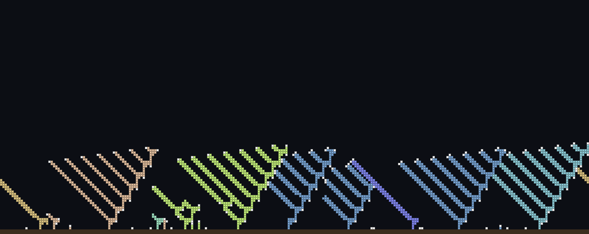

# Digital tree evolution

Trees grow from seeds, compete for sunlight, drop seeds when they die, and mutate. Nobody tells
them what a good tree looks like: there's no fitness function, only a world where some shapes
catch more light and leave more seeds than others.



A Python port of TechnoShaman's Pixilang project "Эволюция цифровых деревьев"
([rules](https://dzen.ru/a/XmMwgmmclhNUOwU2), [code notes](https://dzen.ru/a/XmP6-TDzKWKiXc6x)),
following the author's original source rule for rule.

## Quick start

Needs Python 3.9+ (macOS, Linux or Windows with Git Bash/WSL).

```bash
git clone https://github.com/teacher57/tree-evolution.git
cd tree-evolution
./setup.sh                    # creates .venv/ and installs pygame-ce + Pillow
.venv/bin/python main.py      # opens the window, paused: press SPACE
```

To load the included evolved trees instead of starting from random genomes:

```bash
.venv/bin/python main.py --load genomes/000.json
```

Or install by hand: `pip install -r requirements.txt`, then `python main.py`.

## Controls

| Key | Action |
|---|---|
| `SPACE` | run / pause (it always starts paused) |
| mouse | point at a tree to see its genome, energy and how many trees share it |
| `+` / `-` | speed (ticks per frame) |
| `D` | drawing on/off, a lot faster when off |
| `S` | save genomes of trees with more than 5 cells to `genomes/NNN.json` |
| `L` | choose a save to load (↑/↓ or mouse, Enter/click, Esc to cancel) |
| `R` | restart (from the loaded save, if any) |
| `F` | fullscreen; the window can also be resized |
| `Q` / `Esc` | quit |

The window opens at about 90% of your screen and draws at full Retina/HiDPI resolution.
Trees are drawn in pastel colors hashed from their genome, so **the same color means the same
genes**. Falling seeds use the inverse of their tree's color, and growing tips (sprouts) are white.

## How it works

**World.** A 256×100 grid that wraps around left↔right. The bottom row is the ground.

**Genome.** A table of 16 genes with 4 numbers each (left, up, right, down). A new tree starts
with gene 0 active in its first sprout. When a sprout has enough energy, it reads its gene: for
every direction with a number below 16 (and an empty cell), a new sprout grows there with
*that number* as its active gene. Then the sprout turns into wood. Numbers 16 and up mean "don't
grow". Random genomes use 0–31, so each direction has a 50% chance of growing.

```
gene 0:  L=·  U=1  R=·  D=2     ->  grow up with gene 1 (down is the ground, so nothing grows there)
gene 1:  L=2  U=3  R=·  D=·     ->  grow left with gene 2 and up with gene 3
```

**Sunlight.** In each column the sun reaches the 3 highest cells: the top one gets `3·(y+6)`
energy, the second `2·(y+6)`, the third `1·(y+6)`. Higher cells get more, which is what makes
trees grow tall.

**Energy.** Wood and falling seeds feed the tree's shared energy. Sprouts store energy for
themselves and branch once they have 18. Every cell costs its tree 13 energy per tick, and a
tree whose energy drops below 0 disappears completely.

**Life cycle.** Trees live 88–92 ticks. When a tree dies of old age, its wood vanishes and
every sprout becomes a falling seed, which is a new tree with 300 energy. A seed that lands on
another tree dies; one that reaches the ground takes root.

**Mutation.** Each seed has a 1 in 4 chance of one random genome value being replaced with a
new value from 0–63.

## Headless runs

Run without a window, which is useful for long evolutions or servers:

```bash
.venv/bin/python main.py --headless --steps 60000 --log 5000 --png out.png --save-genomes
```

| Option | Meaning |
|---|---|
| `--steps N` | ticks to run (default 3000) |
| `--log N` | print stats every N ticks |
| `--png FILE` | save the final world as an image |
| `--save-genomes` | save genomes to `genomes/` at the end |
| `--load FILE` | start from a save (works with or without a window) |
| `--seed N` | fixed random seed, for reproducible runs |
| `--no-autorestart` | stop instead of restarting when everything dies |

About 2,000 ticks per second headless on a laptop. The 90 ticks of one tree lifespan count as
one "generation".

## Files

| File | What it is |
|---|---|
| `sim.py` | the simulation: world, genome, sunlight, growth, death, mutation (no dependencies) |
| `main.py` | the pygame window, headless mode, saving and loading |
| `genomes/000.json` | trees evolved for ~1,300 generations, ready to `--load` |
| `setup.sh` | creates a virtualenv and installs the requirements |

## Differences from the original

- When everything dies out it restarts on its own; the original restarts by hand.
- Each tree keeps a set of its cells instead of scanning all 16,000 slots, so the behavior is
  the same but faster.
- Colors are hashed from the genome instead of being inherited and nudged on mutation.
- Saves are JSON instead of Pixilang `.gn` containers.

## Credits

Original idea, rules and Pixilang code by **TechnoShaman**
([article](https://dzen.ru/a/XmMwgmmclhNUOwU2), [YouTube](https://www.youtube.com/c/foo52ru)).
